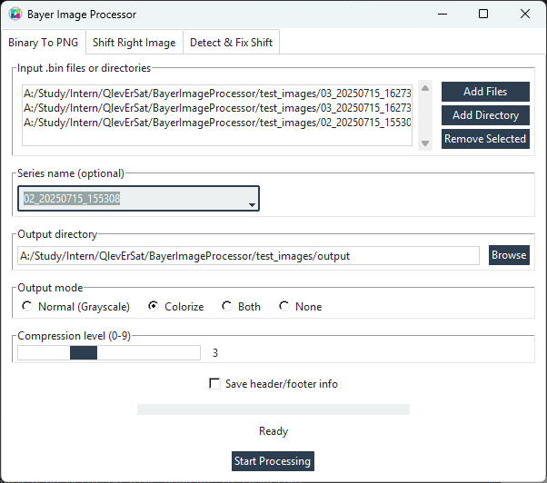

# BayerImageProcessor

Tools to convert, inspect and repair raw Bayer images (`.bin` files) from a satellite-payload camera sensor, with a command-line interface and a small GUI. Python and C/C++ versions of the main tools are provided.

**Author:** Ahmad Asyraf Ahmad Saibudin

I started this during my internship at the [Centre Spatial Universitaire de Grenoble (CSUG)](https://www.csug.fr) in summer 2025, while working on the payload software of a nanosatellite demonstrator, to check and repair the images the payload produced. The GUI and packaging were added in the following days. The source files carry a CSUG copyright notice (CSUG 2022-2025); the tool is published here with the agreement of my CSUG supervisor.



## What it does

- **Converts raw frames to PNG.** A frame is a `.bin` file of 4098 rows of 4096 bytes: row 0 holds an 11-byte header, the last row holds a 66-byte footer, and the 4096 x 4096 rows in between are the 8-bit Bayer (RGGB) image. The tool writes the raw image and/or a colourised version (OpenCV demosaicing).
- **Extracts the header and footer** to a text file, including the analog gain and the integration time (header bytes 9 and 10, little-endian).
- **Pads incomplete files with zeros** so a truncated frame can still be opened.
- **Repairs a one-byte shift.** Frames received over the link are sometimes shifted by a missing byte, which breaks the Bayer pattern. `detectAndFixShift` finds the most likely position of the missing byte and corrects the frame (the lost byte is filled with zero); `shiftRightImage` shifts a chosen region by a given number of bytes.
- **Works on batches**: several files or whole folders, with image series detected from the file names (for example `03_20250715_162736`).
- **GUI** (tkinter and ttkbootstrap): three tabs (Binary To PNG, Shift Right Image, Detect & Fix Shift), input list, output folder and mode, PNG compression level, a progress bar, and processing in a worker thread so the window stays responsive. It also prints the equivalent command line.

## Repository layout

| Path | Content |
|---|---|
| `python/binToPng.py` | conversion and metadata extraction (CLI) |
| `python/BayerImageProcessor.py` | the GUI |
| `python/detectAndFixShift.py`, `shiftRightImage.py`, `diffBinImage.py` | shift detection, shifting, comparing two frames |
| `python/packageBip.sh`, `packageBip.bat` | PyInstaller packaging scripts (Linux/macOS, Windows) |
| `cpp/binToPng.cpp`, `detectAndFixShift.cpp`, `shiftRightImage.c` | C/C++ versions of the same tools |
| `test_images/` | three sample frames (publicly available data) |
| `docs/gui.png` | screenshot |

## Requirements

Python 3 with `numpy`, `opencv-python` and `ttkbootstrap` (tkinter is part of Python; on Debian/Ubuntu install `python3-tk`):

```sh
pip install numpy opencv-python ttkbootstrap
sudo apt-get install python3-tk
```

C/C++ tools: `g++` (C++17), `gcc`, and OpenCV 4 with `pkg-config`.

## Usage

### Command line

```sh
python python/binToPng.py [inputs] [options]
```

| Option | Meaning |
|---|---|
| `inputs` | one or more `.bin` files or folders |
| `-o`, `--output` | output folder (default: current folder) |
| `-m`, `--mode` | `normal`, `colorize`, `both` or `none` (default `colorize`) |
| `-c`, `--compression` | PNG compression, 0 to 9 (default 3) |
| `-hf`, `--headerfooter` | also write the header/footer information |
| `-s`, `--series` | process only one image series, e.g. `03_20250715_162736` |

Examples:

```sh
python python/binToPng.py test_images/03_20250715_162736_04.bin
python python/binToPng.py test_images/ -m both
python python/binToPng.py test_images/03_20250715_162736_04.bin -m none -hf
python python/detectAndFixShift.py input.bin output_fixed.bin
```

Outputs are named after the input (`image.png`, `image_colorize.png`, `image_header_footer.txt`).

### GUI

```sh
python python/BayerImageProcessor.py
```

`python/packageBip.sh` (or `packageBip.bat` on Windows) builds a single-file executable with PyInstaller.

### C/C++ tools

```sh
cd cpp
mkdir -p exe
make test_binToPng.exe test_detectAndFixShift.exe test_shiftRightImage.exe
./exe/test_detectAndFixShift.exe input.bin output.bin
```

`cpp/CMakeLists.txt` is also provided; it was first set up for a Windows build with vcpkg (the presets expect the `VCPKG_ROOT` environment variable; otherwise pass your own `-DCMAKE_TOOLCHAIN_FILE=...`).

## Testing and platforms

Testing is manual: convert the sample frames and compare the Python and C++ outputs. There is no automated test suite.

I used the Python tools and the GUI on Windows and Linux, and built the C/C++ tools on Linux. macOS has not been tested.

## Licence

The source files carry the notice "CSUG 2022-2025. All rights reserved." and no separate licence file is included; please contact CSUG or me before reusing the code.
